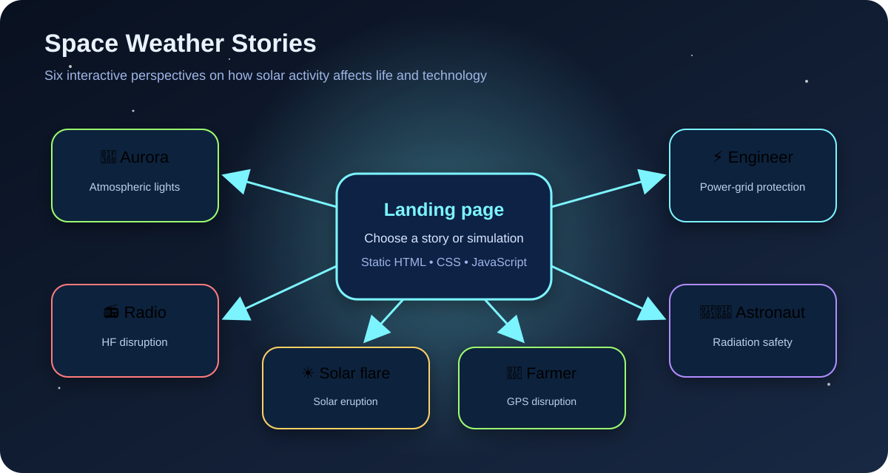
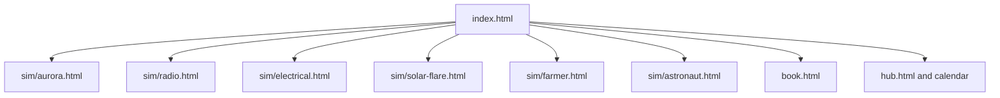
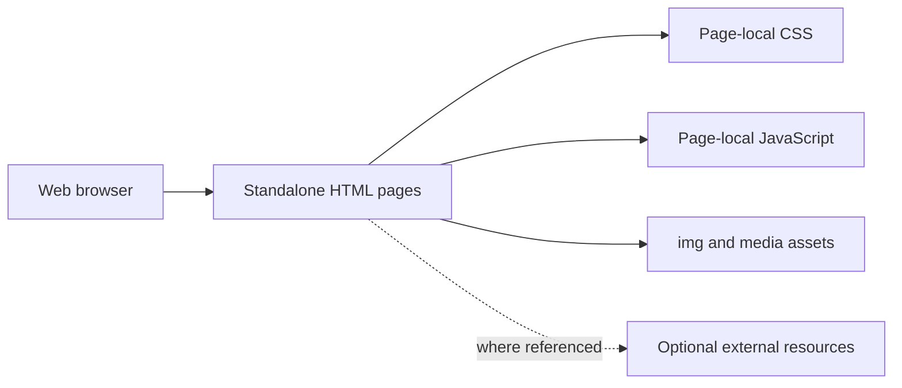

# Space Weather Stories

**An interactive educational website showing how solar activity affects people, infrastructure and technology on Earth and in space.**

<p align="center">
  
</p>

<p align="center">
  
  
  
  
  
</p>

## Overview

Space Weather Stories was built for the **NASA Space Apps Challenge 2025 — Stellar Stories**. It presents space weather through six learner-facing perspectives instead of treating the topic only as an abstract scientific definition.

The site opens with a visual hub and routes visitors to standalone interactive pages about:

- auroras;
- radio communications;
- electrical power systems;
- solar flares;
- GPS-dependent farming;
- astronaut radiation safety.

The repository is a static web project: it has no server-side application, database, package manager or build step.

## Experience map

| Story | Learner perspective | Core topic |
|---|---|---|
| Aurora | Observer of polar lights | Charged particles interacting with Earth’s atmosphere |
| Radio Operator | Communications operator | High-frequency radio disruption |
| Electrical Engineer | Grid operator | Geomagnetically induced effects on power systems |
| Solar Flare | Solar observer | Energetic eruptions from the Sun |
| Farmer | Precision-agriculture user | GPS degradation and navigation disruption |
| Astronaut | Crew member in orbit | Radiation exposure and operational safety |

## User journey



## Main pages

```text
nasa/
├── index.html                 # Main story selection page
├── hub.html                   # Extended hub and calendar content
├── book.html                  # Team/about presentation
├── book.html.backup           # Historical backup
├── sim/
│   ├── aurora.html
│   ├── radio.html
│   ├── electrical.html
│   ├── solar-flare.html
│   ├── farmer.html
│   └── astronaut.html
├── img/                       # Logos and visual assets
├── docs/
│   └── experience-map.svg
├── COPILOT_AGENT_INSTRUCTIONS.md
└── README.md
```

## Run locally

### Option 1: Python HTTP server

```bash
git clone https://github.com/paradis-college/nasa.git
cd nasa
python -m http.server 8000
```

Open:

```text
http://localhost:8000
```

### Option 2: Visual Studio Code Live Server

1. Open the repository in Visual Studio Code.
2. Install the Live Server extension.
3. Right-click `index.html`.
4. Select **Open with Live Server**.

### Why use a local server

Most pages may open directly from disk, but an HTTP server provides behaviour closer to production hosting and avoids browser restrictions around some local asset or module requests.

## Deploy with GitHub Pages

This project is suitable for static hosting.

1. Open repository **Settings**.
2. Open **Pages**.
3. Select **Deploy from a branch**.
4. Choose the default branch and the repository root.
5. Save and wait for the Pages deployment.

No build command or output directory is required because `index.html` is already at the repository root.

## Technical architecture



The current implementation favours self-contained pages. The landing page, for example, keeps its layout, animation and interaction styling inside `index.html`.

### Landing-page behaviour

The landing page provides:

- responsive card layout;
- animated star background;
- hover motion and glow effects;
- dynamic particle effects attached to story cards;
- direct links to each simulation/story;
- links to the project/about page and space-weather calendar.

## Development workflow

Because the project has no compilation step, development is direct:

1. edit an HTML file;
2. refresh the browser;
3. test navigation and interaction;
4. validate on desktop and mobile sizes;
5. commit the changed page and assets.

Suggested smoke checks:

- every card opens the expected page;
- every image resolves with correct case-sensitive paths;
- browser console has no errors;
- keyboard navigation reaches interactive elements;
- text remains readable at narrow widths;
- animations respect user accessibility preferences;
- external links open safely and intentionally.

## Add a new story

1. Create a new page under `sim/`, for example:

```text
sim/satellite.html
```

2. Add a card to the landing-page grid:

```html
<a href="sim/satellite.html" class="element-card satellite">
  <div class="element-icon">🛰️</div>
  <h2 class="element-title">Satellite Operator</h2>
  <p class="element-desc">Respond to spacecraft anomalies during a solar storm</p>
</a>
```

3. Define a card accent:

```css
.satellite {
  --card-color: #7cf4ff;
}
```

4. Add navigation back to the landing page.
5. Test the page with a local server.
6. Update this README’s experience table.

## Content design principles

A strong story page should explain:

1. what solar event is occurring;
2. what system or person is affected;
3. what observable warning signs appear;
4. what decision the learner must make;
5. why the correct action reduces risk;
6. where the scientific explanation comes from.

The goal is not only visual engagement. Each interaction should connect cause, consequence and mitigation.

## Accessibility considerations

Recommended improvements across all pages:

- use semantic buttons and links rather than click-only containers;
- provide visible keyboard focus states;
- add meaningful alternative text to informative images;
- ensure text and controls meet contrast requirements;
- avoid conveying urgency only through colour;
- support `prefers-reduced-motion` for star, particle and card animations;
- verify that simulations remain understandable without audio;
- use headings in a consistent hierarchy.

Example reduced-motion rule:

```css
@media (prefers-reduced-motion: reduce) {
  *, *::before, *::after {
    animation-duration: 0.01ms !important;
    animation-iteration-count: 1 !important;
    scroll-behavior: auto !important;
  }
}
```

## Known limitations

- There is no automated test suite.
- CSS and JavaScript are duplicated across self-contained pages.
- The site has no shared component or template system.
- There is no content-management or translation layer.
- Scientific citations are not centrally indexed in the repository.
- A historical `book.html.backup` file is committed alongside the active page.
- The landing page creates a new particle element on every mouse movement over a card, which may be expensive on lower-powered devices.
- The current dark visual design may need additional contrast checks.
- Not every story’s interaction model is documented from the landing page.
- There is no offline service worker or installable PWA configuration.
- Deployment configuration and live URL are not documented in code.

## Recommended next steps

1. Extract shared colours, typography and layout into a common stylesheet.
2. Extract common navigation and utilities into a shared JavaScript module.
3. Add a central page describing scientific sources and review dates.
4. Add screenshots or short recordings for all six stories.
5. Add automated link and HTML validation in GitHub Actions.
6. Add accessibility testing with Lighthouse or axe.
7. Optimise particle creation and respect reduced-motion preferences.
8. Remove or relocate backup files.
9. Add Open Graph metadata and social preview imagery.
10. Publish a stable GitHub Pages URL in the repository description and README.

## Project context

The website demonstrates how a hackathon team can translate space-weather science into role-based educational scenarios using only browser technologies. Its strongest portfolio value is the combination of science communication, interface design and interactive storytelling.

## Licence

No explicit top-level licence is currently present. Unless a licence is added, repository content remains under the copyright holders’ default rights.
